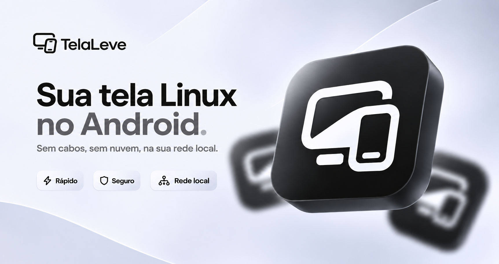

<div align="center">



# TelaLeve

**Sua tela Linux no Android. Sem cabos, sem nuvem, na sua rede local.**

Transmissão de monitor ou janela do **Linux (X11 ou Wayland)** para o **Chrome no Android**, com um emissor em **Rust + Tauri 2 + GStreamer** e vídeo via **WebRTC**.

<br />


[](https://github.com/ThiagoSales17/telaleve/actions/workflows/linux.yml)
[](https://github.com/ThiagoSales17/telaleve/actions/workflows/release.yml)


[**Começar**](#-comece-em-poucos-passos) · [**Como funciona**](#-como-funciona) · [**Downloads**](#-instalação-e-pacotes) · [**Validação**](docs/VALIDATION.md)

</div>

> [!NOTE]
> **Em desenvolvimento — validação parcial.** Há verificações automatizadas e testes nativos registrados em [docs/VALIDATION.md](docs/VALIDATION.md). A validação em Android físico, a transmissão contínua de 30 minutos e a instalação em Debian limpo continuam pendentes.

---

## ✦ O que é o TelaLeve?

O **TelaLeve** permite compartilhar a imagem de um monitor ou de uma janela do desktop Linux com um celular Android conectado à mesma rede. O celular atua como **receptor no navegador**: não é necessário instalar um aplicativo Android dedicado.

| Recurso | Implementação atual |
| :-- | :-- |
| **Origem da captura** | Monitor/janela em **X11** ou pelo **portal/PipeWire** em Wayland |
| **Receptor** | **Chrome para Android**, na rede local |
| **Transmissão** | **WebRTC** com seleção de encoder H.264 ou VP8 |
| **Pareamento** | QR code e aprovação explícita no computador |
| **Acesso** | Um receptor por sessão; código de uso único |
| **Ajustes** | Perfis de qualidade e troca de origem durante a sessão |
| **Distribuição** | **Flatpak**, **`.deb`** e AppImage legado |

## Compatibilidade Linux

A versão **0.2.0** adiciona captura por **portal/PipeWire** para Wayland, inclusive em Flatpak. O instalador de dependências reconhece as famílias **Debian/Ubuntu, Fedora, Arch e openSUSE**. O empacotador Flatpak aceita **x86_64 e ARM64**, com um binário nativo para cada arquitetura.

Consulte [docs/LINUX.md](docs/LINUX.md) para instalação, requisitos do desktop, geração do Flatpak e limites de compatibilidade. A presença de uma implementação não comprova que toda combinação de distribuição, versão, arquitetura e compositor foi testada. A seleção real em Wayland e a experiência no Android continuam no roteiro de validação.

## 🚀 Comece em poucos passos

### 1. Prepare o ambiente

Para usar um pacote pronto em diferentes distribuições, consulte a seção de **Flatpak** abaixo. Para desenvolver pelo código-fonte, tenha **Rust estável**, Node.js/npm, GTK 3, **WebKitGTK 4.1** e **GStreamer 1.20 ou superior**. O script de dependências detecta a família da distribuição. Privilégios de administrador são necessários para instalar dependências do sistema.

Em **X11**, a origem é escolhida na lista do aplicativo. Em **Wayland**, configure PipeWire e um backend ScreenCast de `xdg-desktop-portal` compatível com o desktop, conforme [docs/LINUX.md](docs/LINUX.md).

Execute os comandos a seguir na **raiz do projeto**, onde está o arquivo `package.json`:

```bash
./scripts/install-deps.sh
./scripts/diagnose.sh
npm ci
npm run dev
```

### 2. Conecte o celular

1. No computador, selecione o **monitor ou janela**. Em Wayland, use **Escolher tela ou janela** e autorize no diálogo do sistema; na primeira conexão, **Gerar conexão** também abre o seletor.
2. Escolha a **interface IPv4** e o perfil de qualidade.
3. Clique em **Gerar conexão** e escaneie o QR code no Android.
4. No Chrome, toque em **Conectar**.
5. **Aprove a conexão no computador** para iniciar a transmissão.

O código de pareamento é **de uso único** e expira em **cinco minutos**. Para alterar a origem ou o perfil sem recriar a sessão, use **Aplicar tela e qualidade**. Para revogar o acesso, clique em **Encerrar compartilhamento**.

> [!NOTE]
> O computador e o celular devem estar na **mesma rede local**, sem isolamento entre clientes. Libere **TCP 9876** e o tráfego **UDP negociado pelo WebRTC** no firewall da interface local. **Não configure encaminhamento de portas** no roteador.

## ⚙️ Como funciona

```text
┌─────────────────────────────────────┐
│             Linux / X11 ou Wayland  │
│ X11 ou portal/PipeWire → GStreamer       │
│          Rust + Tauri 2             │
└──────────────────┬──────────────────┘
                   │
       Sinalização local HTTP / WS
            Vídeo via WebRTC
                   │
┌──────────────────▼──────────────────┐
│           Chrome / Android          │
│       Receptor na rede local        │
└─────────────────────────────────────┘
```

**Codificação.** O emissor tenta usar **H.264** (VA, NVIDIA ou QSV) quando o navegador o oferece e um pipeline de teste produz EOS. Se não houver encoder funcional, utiliza **VP8**. A disponibilidade de H.264 depende dos drivers, plugins e recursos do equipamento; os testes já realizados não comprovam a compatibilidade desse encoder em todas as máquinas ou sua decodificação no Android físico.

**Adaptação.** O bitrate é ajustado considerando **perda de pacotes e jitter** informados pelo receptor, respeitando os limites de cada perfil. As resoluções configuradas representam **limites máximos**: imagens menores são centralizadas com bordas, sem ampliação.

**Mudança de origem.** A troca aguarda o primeiro quadro da nova captura e mantém a conexão ativa. Se a nova captura falhar, a origem anterior é preservada. Se a origem atual desaparecer, é necessário selecionar e aplicar uma origem disponível; a negociação é reiniciada automaticamente após essa seleção.

**Reconexão.** O sistema tenta retomar a sessão por até **30 segundos** após uma desconexão detectada e verifica conexões silenciosas com **ping a cada cinco segundos**. O segredo de retomada permanece somente na memória da página: **fechar ou recarregar exige um novo QR code**.

## 🎛️ Perfis de qualidade

| Perfil | Resolução máxima | FPS solicitado | Bitrate inicial | Bitrate máximo |
| :-- | --: | --: | --: | --: |
| **Econômico** | 720p | 20 | 1,5 Mbps | 2,5 Mbps |
| **Equilibrado** · padrão | 720p | 30 | 2,5 Mbps | 4 Mbps |
| **Fluidez** | 720p | 60 | 4 Mbps | 6 Mbps |
| **Nitidez** | 1080p | 30 | 4 Mbps | 6 Mbps |

Para solicitar **60 FPS**, selecione **Fluidez** antes de gerar o QR code ou durante a sessão e clique em **Aplicar tela e qualidade**. A taxa efetivamente entregue depende de **hardware, rede e receptor**.

## 🔐 Segurança e limites da conexão

- O pareamento exige **aprovação no desktop**, com token **descartável** e validade de **cinco minutos**.
- **Apenas um receptor** é aceito por sessão; um segundo é recusado.
- O token **não integra a URL enviada ao servidor HTTP**: é transportado no **fragmento** do QR code, removido da barra de endereço quando a página carrega.
- **A página e a sinalização usam HTTP/WS locais, sem TLS**. O tráfego de vídeo é protegido pelo **WebRTC**.
- O servidor escuta em **todas as interfaces IPv4** (`0.0.0.0:9876`). A interface selecionada altera o endereço do QR code; restrinja o acesso à rede desejada pelo firewall.
- Use somente uma **rede local confiável**. O projeto não foi concebido para exposição direta à internet.

## 📦 Instalação e pacotes

### Flatpak para diferentes distribuições

Os pacotes x86_64 e ARM64 estão na [prévia 0.2.0](https://github.com/ThiagoSales17/telaleve/releases/tag/v0.2.0). Baixe o arquivo da sua arquitetura. Para x86_64, execute:

```bash
flatpak install --user ./TelaLeve-0.2.0-x86_64.flatpak
flatpak run io.github.ThiagoSales17.TelaLeve
```

O pacote usa o runtime **GNOME 51** e seleciona a captura conforme a sessão: X11 direto ou portal/PipeWire em Wayland. Em Wayland, o compositor precisa oferecer ScreenCast. Consulte [docs/LINUX.md](docs/LINUX.md) para ARM64, requisitos, geração do pacote e limitações. Há instaladores x86_64 e ARM64 na release. Um clone Git não contém os instaladores.

### Pacote Debian (`.deb`)

Depois de preparar o ambiente, execute na raiz do projeto para gerar um pacote com o empacotador Tauri:

```bash
./scripts/build-deb.sh
sudo apt install ./src-tauri/target/release/bundle/deb/*.deb
```

Como alternativa, gere o pacote a partir do binário release:

```bash
npm run build:web
cargo build --release --locked --manifest-path src-tauri/Cargo.toml
./scripts/package-binary.sh
```

A versão vem de `package.json` e a arquitetura de `dpkg --print-architecture`. Em um build nativo amd64 da versão 0.2.0:

```bash
sudo apt install ./dist/telaleve_0.2.0_amd64.deb
```

Os binários e a pasta `dist/` **não acompanham um clone Git**. Para instalar um pacote baixado, use o caminho em que o salvou. Um `.deb` exige as bibliotecas compatíveis do sistema em que será instalado; para distribuir entre sistemas com bibliotecas diferentes, use o Flatpak.

### AppImage legado

O arquivo **`TelaLeve-0.1.3-x86_64.AppImage`** é o artefato anterior, voltado a **Debian 13, x86_64 e X11**. Ele não contém as mudanças da versão 0.2.0. Consulte [docs/APPIMAGE.md](docs/APPIMAGE.md) para execução e alternativa sem FUSE. O empacotador manual de AppImage continua específico desse ambiente; o Flatpak é o caminho para ampliar a distribuição.

### Releases

Os instaladores podem ser obtidos nas [**Releases do TelaLeve**](https://github.com/ThiagoSales17/telaleve/releases). **O repositório e suas releases são privados**: é necessário entrar com uma conta que tenha acesso.

## 🧱 Estrutura do projeto

```text
TelaLeve/
├── frontend/
│   ├── desktop/       # Controle do emissor e bridge Tauri
│   ├── viewer/        # Receptor WebRTC e tela cheia
│   └── styles/        # Tema compartilhado
├── web/               # HTML, CSS e JS gerados por build:web
├── src-tauri/src/      # Sessão, servidor, captura e mídia Rust
├── tests/             # frontend/, linux/, release/ e core/
├── scripts/           # Build, diagnóstico e empacotamento
├── docs/              # Guias, arquitetura, validação e imagens
├── .github/           # CI, releases, templates e Dependabot
├── CONTRIBUTING.md    # Como preparar e contribuir
└── SECURITY.md        # Política de segurança
```

Edite a interface em `frontend/` e execute `npm run build:web` para atualizar `web/`. O diretório gerado é versionado para a compilação Rust e conferido pelo CI. Binários, caches e dependências **não são versionados**. Consulte o [guia da arquitetura](docs/architecture.md) e o [mapa dos testes](tests/README.md).

## 🧪 Testes e validação

Depois de preparar o ambiente e instalar as dependências npm, execute na raiz do projeto:

```bash
cargo test --manifest-path tests/core/Cargo.toml
npm run check
npm run build:web
npm test
cargo test --manifest-path src-tauri/Cargo.toml
cargo fmt --manifest-path src-tauri/Cargo.toml --check
python3 tests/linux/scripts.test.py
```

Os testes de `tests/core` exercitam o mesmo modelo de acesso sem precisar inicializar GTK ou GStreamer. `npm test` executa os testes de tela cheia sobre o JavaScript gerado por `npm run build:web`.

O teste nativo de integração é **ignorado por padrão** porque exige uma sessão X11 acessível e os plugins GStreamer. Para executá-lo explicitamente no computador alvo:

```bash
cargo test --manifest-path src-tauri/Cargo.toml -- --include-ignored
```

Essas verificações não substituem os testes com um receptor real. A seleção e transmissão reais por **Wayland/portal**, a experiência em **Android físico**, a sessão contínua de **30 minutos** e a instalação em sistemas limpos continuam pendentes. Os testes de pipeline não substituem essas verificações. Consulte [docs/VALIDATION.md](docs/VALIDATION.md) para os resultados registrados e o roteiro manual de aceite.

### Medir o consumo de recursos

Durante a transmissão, identifique o PID do processo emissor e execute:

```bash
python3 scripts/measure.py PID --seconds 1800 --output telaleve.csv
```

Repita a medição com o processo principal do **Deskreen**, usando a mesma configuração, para uma comparação controlada. O CSV registra **CPU relativa a um núcleo** e a **soma do RSS da árvore de processos** (páginas compartilhadas podem ser contabilizadas em mais de um processo). O script **não mede uso de GPU nem latência entre telas**. Não há alegação de superioridade de desempenho sem dados comparativos.

## 🗺️ Escopo desta versão

O foco atual é **compartilhar vídeo do Linux para um único Chrome no Android pela rede local**, com captura X11 e implementação Wayland por portal/PipeWire ainda em validação. Os seguintes recursos estão **fora do escopo da versão atual**:

- Transmissão de áudio
- Controle remoto do computador
- Monitor virtual
- Acesso pela internet
- Múltiplos receptores simultâneos

## Releases automáticas

O workflow [Release](https://github.com/ThiagoSales17/telaleve/actions/workflows/release.yml) compila, testa e empacota **Flatpak e `.deb` para x86_64 e ARM64**. Cada push na `main` publica automaticamente uma **prévia do commit**, com tag `dev-<SHA>`, após os dois builds passarem. Os pacotes dessas prévias mantêm a versão-base do projeto, sem incrementar silenciosamente o SemVer; a tag identifica o build. Envios com vários commits geram uma prévia do último commit. Tags `vMAJOR.MINOR.PATCH` continuam publicando as releases versionadas. Commits com `[skip ci]` não executam o workflow. Versões `0.x` e versões com sufixo, como `-beta.1`, são publicadas como prévias.

Antes de criar a tag, atualize a mesma versão em `package.json`, `package-lock.json`, `src-tauri/Cargo.toml`, `src-tauri/Cargo.lock` e `src-tauri/tauri.conf.json`. O workflow recusa versões divergentes e tags que não correspondam ao código. Exemplo, depois de preparar a versão 0.2.1:

```sh
git tag -a v0.2.1 -m "TelaLeve 0.2.1"
git push origin v0.2.1
```

Para publicar uma versão SemVer, siga o exemplo acima. O botão **Run workflow** executa os builds e disponibiliza os pacotes como artefatos durante 14 dias, sem publicar uma release. Não é necessário cadastrar um token pessoal: a publicação usa o token temporário do GitHub, com permissão de escrita somente no job de publicação.

Releases já publicadas não são sobrescritas. Para corrigir uma release, publique uma nova versão PATCH. Para voltar a uma versão anterior, baixe seus pacotes na página de Releases; remover ou mover tags não faz rollback de instalações existentes. Falhas nos testes ou em qualquer arquitetura impedem a publicação.

## Roadmap

A compatibilidade será validada por **ambientes representativos**, cobrindo dependências, X11, Wayland e o runtime Flatpak. Não é necessário testar cada distribuição existente.

### Concluído nesta etapa

- [x] Implementar captura X11 com fallback quando RandR não está disponível.
- [x] Implementar seleção Wayland por portal ScreenCast/PipeWire, com autorização do sistema.
- [x] Preparar dependências para Debian/Ubuntu, Fedora, Arch e openSUSE.
- [x] Gerar Flatpak x86_64 e testar captura X11 e inicialização no runtime GNOME 51.
- [x] Executar 14 testes nativos, incluindo trocas de origem, cancelamento de sessão e limite de quadros de taxa variável.

### Próximas etapas

- [ ] Retomar e concluir a conferência CI de Ubuntu 22.04 e 24.04 x86_64. Na pausa, Fedora, Arch, openSUSE e Ubuntu 24.04 ARM64 já haviam passado na [execução da versão final](https://github.com/ThiagoSales17/telaleve/actions/runs/45293401929).
- [ ] Validar seleção, transmissão, cancelamento pelo compositor, troca de origem e reconexão em desktops Wayland reais representativos, como GNOME e KDE.
- [ ] Validar com Android físico: pareamento, aprovação, vídeo, codecs, tela cheia e reconexão.
- [ ] Executar uma sessão contínua de 30 minutos e registrar estabilidade e consumo de recursos.
- [ ] Testar a instalação do Flatpak em uma amostra de sistemas limpos, com drivers e backends de portal representativos.
- [ ] Gerar e validar um Flatpak ARM64 em equipamento real; o teste de build ARM64 não substitui esse aceite.
- [x] Publicar a [prévia 0.2.0](https://github.com/ThiagoSales17/telaleve/releases/tag/v0.2.0) com instaladores x86_64/ARM64, checksums e resultados de validação.

**Ponto de pausa: 23/11/2026.** Atividades encerradas a pedido do responsável. Posteriormente, a prévia 0.2.0 foi publicada por solicitação do responsável; detalhes técnicos e limitações estão em [docs/VALIDATION.md](docs/VALIDATION.md) e [docs/LINUX.md](docs/LINUX.md).

## Contribuição

Veja [CONTRIBUTING.md](CONTRIBUTING.md) para setup, comandos de qualidade e pull requests. `npm run format` aplica a formatação; `npm run format:check` verifica sem editar. Reportes de vulnerabilidade seguem [SECURITY.md](SECURITY.md).

## Licença

O código do TelaLeve é distribuído sob a **licença MIT**. Consulte [LICENSE](LICENSE) para o texto completo. Dependências e componentes de terceiros mantêm suas respectivas licenças.

---

<div align="center">

**TelaLeve** · Em desenvolvimento · Validação parcial

[Validação](docs/VALIDATION.md) · [AppImage](docs/APPIMAGE.md) · [Histórico](docs/HISTORY.md) · [Releases](https://github.com/ThiagoSales17/telaleve/releases)

</div>
