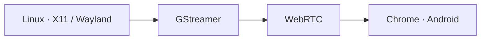

<div align="center">


# TelaLeve

**Sua tela Linux no Android. Sem cabos, sem nuvem, na sua rede local.**

Compartilhe seu monitor ou uma janela do Linux com o Chrome no Android, sem instalar um aplicativo no celular.


[**Download**](https://github.com/ThiagoSales17/telaleve/releases) · [Instalação](#instalação) · [Como usar](#como-usar) · [Documentação](#documentação)

</div>

---

## O que é o TelaLeve?

TelaLeve é um aplicativo desktop desenvolvido em **Rust, Tauri 2 e GStreamer** que transmite a imagem de um monitor ou janela Linux para o navegador do celular por **WebRTC**.

- Captura de monitor ou janela em X11 e Wayland.
- Conexão local por QR code, sem serviços de nuvem.
- Codificação H.264 quando disponível, com fallback para VP8.
- Bitrate adaptativo e quatro perfis de qualidade.
- Troca de origem durante a transmissão e tentativa de reconexão automática.
- Pareamento com aprovação explícita no computador.

> [!NOTE]
> A versão 0.2.0 é uma prévia com validação parcial. Consulte [Testes e validação](#testes-e-validação) para conhecer o estado atual.

## Instalação

Baixe os pacotes na página de [Releases](https://github.com/ThiagoSales17/telaleve/releases).

### Flatpak — recomendado

Disponível para x86_64 e ARM64. Baixe o arquivo correspondente à sua arquitetura. Exemplo para x86_64:

```bash
flatpak install --user ./TelaLeve-0.2.0-x86_64.flatpak
flatpak run io.github.ThiagoSales17.TelaLeve
```

O pacote utiliza o runtime GNOME 51. Consulte [LINUX.md](docs/LINUX.md) para requisitos e instruções adicionais.

### Debian / Ubuntu (.deb)

Após baixar o pacote correspondente à sua arquitetura, instale-o com `apt`. Exemplo para amd64:

```bash
sudo apt install ./telaleve_0.2.0_amd64.deb
```

O pacote depende de bibliotecas compatíveis com o sistema. Para maior portabilidade entre distribuições, prefira o Flatpak.

### Executar pelo código-fonte

Requer Rust estável, Node.js/npm, GTK 3, WebKitGTK 4.1 e GStreamer 1.20 ou superior.

Na raiz do projeto:

```bash
./scripts/install-deps.sh
./scripts/diagnose.sh
npm ci
npm run dev
```

## Como usar

1. Conecte o computador e o celular à mesma rede local.
2. Selecione o monitor ou a janela que deseja compartilhar. Em Wayland, autorize a captura no seletor do sistema.
3. Escolha a interface IPv4 e o perfil de qualidade.
4. Clique em **Gerar conexão** e escaneie o QR code no Android.
5. Toque em **Conectar** no Chrome e aprove a conexão no computador.

Use **Aplicar tela e qualidade** para alterar a captura ou o perfil durante a sessão. Para finalizar, clique em **Encerrar compartilhamento**.

## Como funciona



O aplicativo desktop utiliza Rust e Tauri 2 para gerenciar a captura, o pareamento e a sessão. O GStreamer processa e codifica o vídeo, enquanto o WebRTC realiza a transmissão pela rede local, com sinalização HTTP/WebSocket.

O bitrate é ajustado conforme a perda de pacotes e o jitter. Em caso de desconexão detectada, o sistema tenta recuperar a sessão por até 30 segundos. Recarregar ou fechar a página exige um novo pareamento.

### Perfis de qualidade

| Perfil | Resolução máxima | FPS solicitado | Bitrate inicial / máximo |
| :-- | :--: | --: | :--: |
| Econômico | 720p | 20 | 1,5 / 2,5 Mbps |
| **Equilibrado (padrão)** | 720p | 30 | 2,5 / 4 Mbps |
| Fluidez | 720p | 60 | 4 / 6 Mbps |
| Nitidez | 1080p | 30 | 4 / 6 Mbps |

A resolução e a taxa de quadros efetivas dependem da origem, do hardware, da rede e do receptor.

## Compatibilidade

| Ambiente | Suporte |
| :-- | :-- |
| X11 | Captura implementada e testada nativamente |
| Wayland | Captura via ScreenCast/portal e PipeWire; validação prática pendente |
| Debian / Ubuntu | Script de dependências e pacote `.deb` |
| Fedora / Arch / openSUSE | Script de dependências e distribuição via Flatpak |
| x86_64 / ARM64 | Pacotes disponíveis |
| Android | Receptor via Chrome ou Demais Navegadores |

O suporte implementado não implica validação em todas as distribuições, arquiteturas e compositores. Consulte [LINUX.md](docs/LINUX.md) para requisitos específicos.

O escopo atual é a transmissão de vídeo para um único receptor. Áudio, controle remoto, monitor virtual e acesso pela internet não fazem parte desta versão.

## Segurança

- Código de pareamento de uso único, válido por cinco minutos.
- Aprovação obrigatória no desktop e um receptor por sessão.
- Vídeo protegido pelo WebRTC; página e sinalização locais via HTTP/WS, sem TLS.
- Token transportado no fragmento da URL, sem envio ao servidor HTTP.

> [!IMPORTANT]
> Utilize somente redes locais confiáveis. O servidor escuta em `0.0.0.0:9876`; restrinja o acesso pelo firewall, permitindo TCP 9876 e o tráfego UDP negociado pelo WebRTC na rede desejada. Não configure encaminhamento de portas no roteador.

## Testes e validação

Após instalar as dependências do projeto:

```bash
cargo test --manifest-path tests/core/Cargo.toml
npm run check
npm run build:web
npm test
cargo test --manifest-path src-tauri/Cargo.toml
cargo fmt --manifest-path src-tauri/Cargo.toml --check
python3 tests/linux/scripts.test.py
```

O teste nativo de integração exige uma sessão X11 acessível e os plugins GStreamer:

```bash
cargo test --manifest-path src-tauri/Cargo.toml -- --include-ignored
```

Há verificações automatizadas e testes nativos registrados, incluindo captura X11. A validação completa em Wayland, Android físico, sessões prolongadas e instalações em sistemas limpos permanece pendente.

Consulte [VALIDATION.md](docs/VALIDATION.md) para resultados e critérios de aceite.

## Roadmap

- [ ] Validar captura e transmissão em desktops Wayland representativos.
- [ ] Ampliar a validação de instalação e compatibilidade, incluindo hardware ARM64.

## Documentação

| Documento | Conteúdo |
| :-- | :-- |
| [LINUX.md](docs/LINUX.md) | Compatibilidade, dependências e empacotamento |
| [VALIDATION.md](docs/VALIDATION.md) | Testes, resultados e critérios de validação |
| [HISTORY.md](docs/HISTORY.md) | Histórico de desenvolvimento |
| [Releases](https://github.com/ThiagoSales17/telaleve/releases) | Instaladores e versões disponíveis |

## Licença

Distribuído sob a licença [MIT](LICENSE). Componentes de terceiros mantêm suas respectivas licenças.

---

<div align="center">

**TelaLeve** · Rust + Tauri + GStreamer + WebRTC

[Downloads](https://github.com/ThiagoSales17/telaleve/releases) · [Documentação](docs/LINUX.md) · [Validação](docs/VALIDATION.md)

</div>
