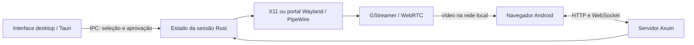

# Arquitetura

O desktop Tauri executa a interface de controle. Rust gerencia aprovação, sessão e captura; o Android recebe o vídeo pelo navegador, sem aplicativo dedicado.

## Código e assets

| Diretório | Responsabilidade |
| --- | --- |
| `frontend/desktop/` | Interface de controle e bridge IPC Tauri |
| `frontend/viewer/` | Conexão WebRTC do receptor e tela cheia |
| `frontend/styles/` | Estilos compartilhados entre desktop e receptor |
| `web/` | Assets gerados, consumidos pelo Tauri e incluídos no binário Rust |
| `src-tauri/src/main.rs` | Inicialização, comandos Tauri e controle de sessão |
| `src-tauri/src/server.rs` | Rotas HTTP e assets do receptor |
| `src-tauri/src/model.rs` | Modelo de acesso, origens e qualidade |
| `src-tauri/src/capture.rs`, `platform.rs`, `portal.rs` | Seleção de backend e captura |
| `src-tauri/src/media.rs` | Pipeline de mídia, codecs e troca de origem |
| `tests/` | Suítes separadas por responsabilidade; veja [guia dos testes](../tests/README.md) |
| `scripts/` | Build, sincronização dos assets, diagnóstico e empacotamento |

`npm run build:web` compila TypeScript mantendo a estrutura de módulos e copia HTML/CSS para `web/`. Edite os fontes em `frontend/`, não os arquivos gerados. Os gerados permanecem versionados para permitir compilação Rust direta e detectar divergências no CI.

O servidor entrega `/`, `/style.css`, `/viewer/main.js`, `/viewer/fullscreen.js` e `/ws`. O desktop carrega `web/index.html` pelo Tauri; a bridge IPC pertence apenas à interface desktop.

## Limites

A sinalização HTTP/WebSocket não usa TLS e o servidor escuta em IPv4. O uso previsto é em uma rede local confiável. O vídeo usa WebRTC. Requisitos e verificações efetivamente realizadas estão em [LINUX.md](LINUX.md) e [VALIDATION.md](VALIDATION.md).
